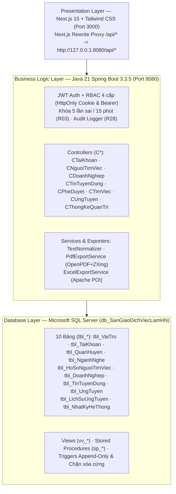

# ARCHITECTURE.md — KIẾN TRÚC HỆ THỐNG SÀN GIAO DỊCH VIỆC LÀM TRỰC TUYẾN HÀ NỘI (`SE.G01`)

> **Dự án**: Phát triển phần mềm Sàn giao việc làm trực tuyến cho Trung tâm Dịch vụ việc làm Hà Nội  
> **Nhóm thực hiện**: `SE.G01` — Khoa Công nghệ Thông tin, Trường Đại học Mở Hà Nội (`FIT HOU`)  
> **Giảng viên hướng dẫn**: Th.S Lê Hữu Dũng  

---

## 1. Bảng Đề Xuất Ngôn Ngữ & Kiến Trúc (Khớp 100% Mục 4.3 & Mục 4.4 Báo Cáo)

| Thành phần | Công nghệ & Chuẩn áp dụng | Lý do & Phù hợp quy chuẩn FIT HOU |
| :--- | :--- | :--- |
| **Frontend (Presentation Layer)** | **Next.js 15 (App Router)** + **React 19** + **TypeScript** + **Tailwind CSS** | Giao diện sạch trên nền sáng `#F6F8FB` / `#FFFFFF`, Responsive hoàn chỉnh trên Desktop, Tablet, Smartphone (`OBJ-05`), dàn trang in khổ A4 (`210 × 297 mm`), ký hiệu điều khiển chuẩn § 2.2 (`lb*`, `tb*`, `cb*`, `cbb*`, `dgv*`, `pn*`, `btn*`). |
| **Backend (Business Logic Layer)** | **Java 21** + **Spring Boot 3.3.5** (Maven) + **Spring Security (BCrypt + JWT)** | Tổ chức phân lớp **3 tầng kết hợp MVC** (`Model/M*`, `Dto/V*`, `Controller/C*`, `Service/*`, `Repository/*`), thực thi trọn vẹn **6 phân hệ / 28 chức năng (`R01` → `R28`)**, kết xuất PDF tiếng Việt UTF-8 (**OpenPDF + ZXing QR**) và Excel `.xlsx` có công thức (**Apache POI**). |
| **Database (Database Layer)** | **Microsoft SQL Server** (`db_SanGiaoDichViecLamHN`) | Chính xác **10 bảng vật lý `tbl_*`** (§ 4.6), tiền tố chuẩn § 2.2 (`PK_`, `FK_`, `vv_`, `sp_`, `i`, `f`, `s`, `d`, `b`, `t`), ràng buộc kiểm tra, xóa mềm (`bDaXoa = 1`), nhật ký Append-Only chống sửa/xóa (`trg_BaoVeNhatKyHeThong`, `trg_BaoVeLichSuUngTuyen`), 30 quận/huyện Hà Nội. |
| **Hạ tầng kết nối CSDL Local** | **SQL Server LocalDB (`MSSQLLocalDB`)** + `Scripts/sqlserver_localdb_bridge.mjs` (hoặc `SQLEXPRESS` TCP `1433`) | Cho phép máy dev chạy SQL Server thật ở quyền user thông thường qua cầu nối TCP-to-Named-Pipe (`127.0.0.1:14333`), đồng thời cung cấp profile `sqlexpress` (`localhost:1433`) cho môi trường SSMS truyền thống. |

---

## 2. Sơ Đồ Kiến Trúc 3 Tầng Client–Server & 6 Phân Hệ Nghiệp Vụ



### Bản đồ 6 Phân Hệ (`R01` → `R28`)
1. **Phân hệ 1 — Quản lý Tài khoản & Phân quyền (`R01`–`R05`)**: Đăng ký & kích hoạt email (`R01`), Đăng nhập JWT + phân luồng 4 vai trò RBAC (`R02`), Tự động khóa 15 phút khi sai 5 lần (`R03`), Cập nhật thông tin/ảnh đại diện/đổi mật khẩu (`R04`), Admin phân quyền & khóa/mở khóa tài khoản (`R05`).
2. **Phân hệ 2 — Quản lý Hồ sơ Người tìm việc (`R06`–`R09`)**: Tạo & chuẩn hóa chuỗi Unicode/CCCD 12 số không dính chữ (`R06`), Bật/tắt tìm việc công khai (`R07`), Tải lên & kiểm tra Magic Bytes PDF CV $\le 5\text{MB}$ (`R08`), Kết xuất Phiếu đăng ký tìm việc PDF A4 kèm QR (`R09`).
3. **Phân hệ 3 — Quản lý Tuyển dụng & Doanh nghiệp (`R10`–`R13`)**: Nộp hồ sơ pháp lý & scan GPKD (`R10`), Đăng tin tuyển dụng mới (`R11`), Chỉnh sửa (reset về Chờ duyệt) / Đóng tin / Gia hạn tin (`R12`), Xem ứng viên nộp & tải CV (`R13`).
4. **Phân hệ 4 — Kiểm duyệt Nghiệp vụ Cán bộ (`R14`–`R17`)**: Thẩm định pháp lý doanh nghiệp (`R14`), Phê duyệt / Từ chối tin kèm lý do (`R15`), Gỡ bỏ khẩn cấp tin vi phạm (`R16`), Cấp & xuất Giấy giới thiệu việc làm PDF A4 kèm số công văn & QR (`R17`).
5. **Phân hệ 5 — Khớp nối Cung - Cầu & Ứng tuyển (`R18`–`R23`)**: Tìm kiếm việc làm đa tiêu chí AND $\le 1{,}5\text{s}$ (`R18`), Tra cứu ứng viên công khai che thông tin nhạy cảm theo NĐ 13/2023 (`R19`), Nộp hồ sơ trực tuyến chống trùng (`R20`), Tiếp nhận (tự chuyển `0->1` khi xem), cập nhật xét duyệt & lịch phỏng vấn (`R21`), Theo dõi tiến trình & lịch sử thời gian thực (`R22`), Hủy ứng tuyển khi chưa xét (`R23`).
6. **Phân hệ 6 — Thống kê & Quản trị Danh mục (`R24`–`R28`)**: Thống kê cung–cầu theo ngành & quận/huyện (`R24`), Xuất báo cáo Sở LĐ-TB&XH PDF/Excel có công thức (`R25`), Quản trị danh mục ngành nghề (`R26`), Quản trị 30 quận/huyện Hà Nội chặn xóa cứng (`R27`), Giám sát & xuất Excel Audit Log Append-Only (`R28`).

---

## 3. Cấu Trúc Thư Mục Dự Án (`D:\san-giao-dich-viec-lam-hanoi`)

```text
D:\san-giao-dich-viec-lam-hanoi\
├── .agents/                        # Cấu hình Multi-Agent (@architect, @coder, @reviewer, @tester)
├── .vscode/                        # Cấu hình VS Code Tasks, Settings, Extensions
├── Database/
│   └── db_san_giao_dich_viec_lam_hn.sql   # Script SQL Server đầy đủ: 10 bảng, Views, SPs, Triggers, 30 Quận/Huyện & Seed Data
├── Backend/                        # Java 21 + Spring Boot 3.3.5 Maven Project
│   ├── pom.xml
│   └── src/main/java/vn/gov/hanoi/dvvl/
│       ├── Config/                 # SecurityConfig, JwtAuthenticationFilter, CorsConfig
│       ├── Controller/             # CTaiKhoan, CNguoiTimViec, CDoanhNghiep, CTinTuyenDung, CPheDuyet, CTimViec, CUngTuyen, CThongKeQuanTri
│       ├── Dto/                    # VTaiKhoan, VNguoiTimViec, VDoanhNghiep, VTinTuyenDung, VPheDuyet, VTimViec, VUngTuyen, VBaoCaoCungCau, VNhatKyHeThong
│       ├── Model/                  # MVaiTro, MTaiKhoan, MQuanHuyen, MNganhNghe, MHoSoNguoiTimViec, MDoanhNghiep, MTinTuyenDung, MUngTuyen, MLichSuUngTuyen, MNhatKyHeThong
│       ├── Repository/             # Spring Data JPA Repositories + Stored Procedure/View queries
│       └── Service/                # JwtService, AuditLogService, TextNormalizer, IdGeneratorService, PdfExportService, ExcelExportService, BusinessException
├── Frontend/                       # Next.js 15 App Router + React 19 + Tailwind CSS
│   ├── next.config.ts              # Rewrite proxy /api/* -> http://127.0.0.1:8080/api/*
│   └── src/
│       ├── app/                    # Các route thực tế cho Khách, NTV, Doanh nghiệp, Cán bộ DVVL, Admin
│       ├── components/             # AppShell, Header, Pagination, StatusBadge, ChartPanel, PrintableForms
│       ├── lib/                    # apiClient.ts, authContext.tsx, formatters.ts
│       └── types/                  # models.ts khớp 1:1 DTO V*
├── Scripts/
│   ├── sqlserver_localdb_bridge.mjs # Cầu nối TCP 127.0.0.1:14333 -> Named Pipe MSSQLLocalDB
│   └── start_all.bat               # Khởi chạy 1-Click LocalDB + Bridge + Backend + Frontend
├── ARCHITECTURE.md
├── API_CONTRACT.md
├── DESIGN.md
├── PLAN.md
├── CONTEXT.md
├── BAO_CAO_CHUONG_5_6_VA_DONG_BO.md
└── README.md
```
